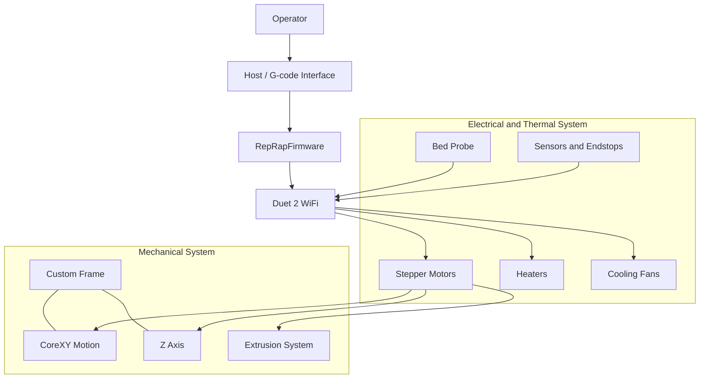

# System Architecture

## 1. Purpose

This document describes the system-level architecture
of the custom CoreXY 3D printer.

## 2. Architecture overview

The printer is an integrated electromechanical system
consisting of mechanical, electrical, thermal and
embedded control subsystems.

The primary motion controller is a Duet 2 WiFi
running RepRapFirmware.

## 3. Functional architecture

## 4. Subsystem descriptions

### 4.1 Structural subsystem

Provides the mechanical foundation for all
machine components.

Architecture:
- Custom frame.
- Mechanical mounting interfaces.
- Motion-system support structures.

### 4.2 Motion subsystem

Provides controlled movement along X, Y and Z.

Architecture:
- CoreXY XY kinematics.
- Z-axis movement.
- Stepper motor actuation.
- Position feedback through configured
  endstops and probing hardware.

### 4.3 Thermal subsystem

Provides controlled heating and temperature
monitoring for the printing process.

Components:
- Hotend heater.
- Heated bed, if installed.
- Temperature sensors.
- Cooling fans.

### 4.4 Control subsystem

The Duet 2 WiFi executes RepRapFirmware.

Responsibilities:
- Motion control.
- Motor driver control.
- Endstop monitoring.
- Probe interface.
- Heater control.
- Temperature monitoring.
- Fan control.

## 5. System interfaces

The interfaces between subsystems shall be
documented in the Interface Control Document.

## 6. Architecture assumptions

Only the Duet 2 WiFi controller and CoreXY
kinematics are established by the current baseline.

Actual component assignments, signal paths and
mechanical arrangements shall be confirmed
against the physical machine.

